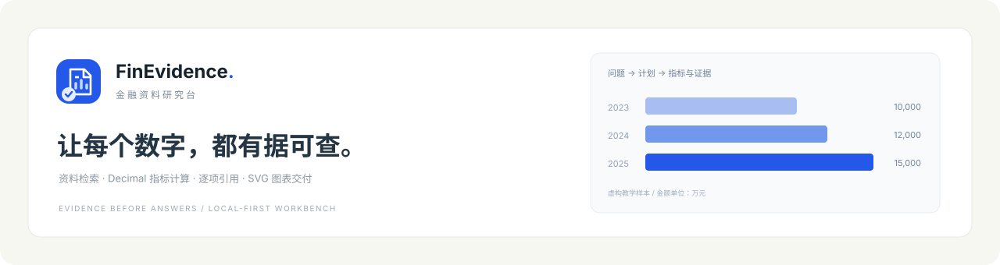
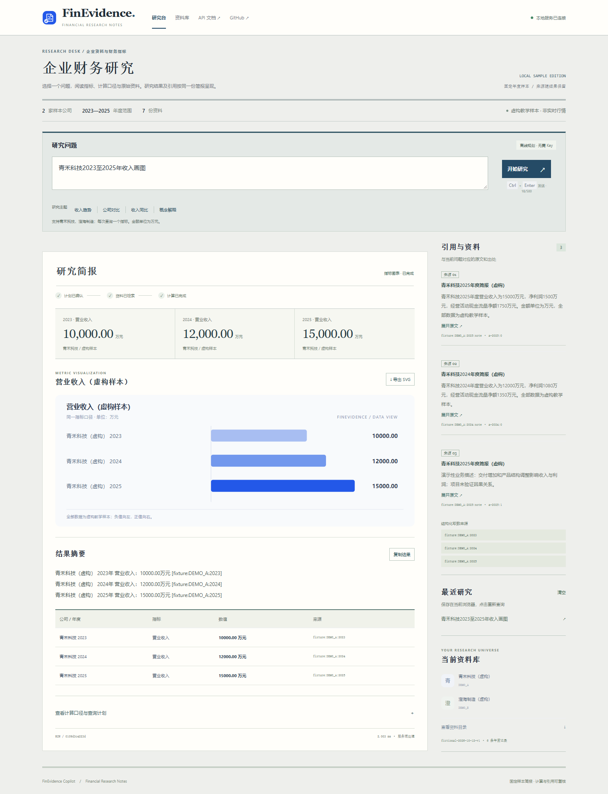
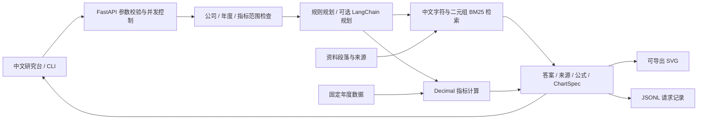

# FinEvidence Copilot

> 青禾科技 2025 年营业收入同比是多少？数字依据哪两年的资料？

在内置虚构样本中，2025 年收入为 15000 万元，2024 年为 12000 万元；同比由程序计算为 **25.00%**。研究简报同时保留公式、取数来源和说明资料，概念问题则返回检索摘录与原文。

| 研究范围 | 当前样本 |
| --- | --- |
| 公司 | 青禾科技、澄海制造，两家虚构公司 |
| 年度与资料 | 2023-2025，6 条年度记录、7 份资料 |
| 计算 | Decimal 数值、同比基期、净利率与来源 |
| 规划 | 默认规则；可选 LangChain 结构化模型接口 |

这些数据用于复核查询流程，不是实时行情。默认无需模型密钥；尚未完成真实模型 API 的准确率评测。

## 阅读一份研究简报



| 任务 | 页面能力 |
| --- | --- |
| 指标查询 | 年度数值卡、完整明细表、计算公式与取数来源 |
| 公司比较 | 同年度、同口径的两家公司指标并列展示 |
| 资料解释 | 财务概念摘录、片段引用、可展开原文 |
| 图表交付 | 服务端原生 SVG、正负值零轴、下载已显示图表 |
| 查询重放 | 当前浏览器保存最近 8 个问题，点击重新执行 |
| 过程检查 | 任务类型、公司与年度范围、规划模式、资料版本和运行 ID |

界面按研究文档组织：上方横向问题栏、左侧简报正文、右侧引用与资料目录。衬线标题、细线分隔、连续数值栏与方角版面用于阅读和比较，支持手机屏幕、键盘提交、等待与失败状态。页面数据通过同源 FastAPI 接口读取，不依赖 npm、CDN 或外部字体。详见[交互与实现说明](docs/FRONTEND.md)。

## 快速运行

需要 Python 3.11+ 与 uv。

```bash
git clone https://github.com/00lostin00/FinEvidenceCopilot.git
cd FinEvidenceCopilot
uv sync --frozen --all-extras
uv run --frozen --all-extras uvicorn finevidence.api:app --host 127.0.0.1 --port 8012
```

打开 **http://127.0.0.1:8012/** 使用研究台；接口文档在 `/docs`。首次打开会执行“青禾科技2023至2025年收入画图”，可点击公司对比、收入同比或概念解释继续查询。

也可以直接运行 CLI：

```bash
uv run --frozen --all-extras finevidence "青禾科技2025年营业收入同比"
uv run --frozen --all-extras finevidence "青禾科技2023至2025年收入画图" --svg data/revenue.svg
```

| 接口 | 功能 |
| --- | --- |
| `GET /` | 中文交互研究台 |
| `GET /health` | 服务状态、规划模式、资料版本 |
| `GET /v1/catalog` | 已加载公司、年度、指标与资料目录 |
| `POST /v1/ask` | 接受 `{"question":"青禾科技2025年营业收入同比"}`，返回计划、数字与证据 |
| `POST /v1/chart.svg` | 接受同格式的图表问题，返回 SVG |

## 问题、计算与资料怎样对应



- 查询范围先检查，缺失年度、未支持指标、实时数据问题返回澄清或无证据，不自动补成确定答案。
- 检索保留公司、年度与来源过滤；概念问题只检索概念资料，避免引用另一家公司的说明。
- 金额使用 Decimal，不依靠模型生成数字；净利率和收入同比均带公式，缺少正值上年收入时不计算同比。
- 图表规格限制为同指标、同单位的条形图，服务端转义文本后生成 SVG。
- 页面使用 `textContent`、同源请求、CSP 与固定静态目录；没有把用户输入作为 HTML 或文件路径执行。

## 验证与可复现结果

```bash
uv run --frozen --all-extras pytest
uv run --frozen --all-extras ruff check .
uv run --frozen --all-extras python tools/evaluate.py
uv run --frozen --all-extras python tools/smoke_http.py
```

验证覆盖指标口径、单位、缺失年度、引用范围、图表、接口、前端示例契约和静态路径边界；另有 24 条离线固定回归。[既有数值验证记录](docs/validation/validation.md)保留原始报告。测试数量以当前运行输出为准。

固定样本可直接核对：青禾科技 2025 年收入 15000.00 万元、收入同比 25.00%、净利率 10.00%；澄海制造同年净利率 4.00%。这些是虚构数据的程序结果，不是模型准确率或真实业务收益。

[浏览器验收记录](docs/validation/browser-workbench.json)记录示例查询、无证据状态、错误恢复、SVG 下载和桌面/手机检查。

## 参考与范围比较

下面的项目用于理解技术路径与应用取舍，均链接到官方仓库。比较讨论范围与实现方式，没有接入这些项目，也没有进行横向性能测试。

| 项目 | 官方项目侧重 | 本项目的范围与取舍 |
| --- | --- | --- |
| [RAGFlow](https://github.com/infiniflow/ragflow) | 文档理解、检索增强与 Agent 工作流，提供资料引用能力 | 保留小型中文 BM25 与显式公司/年度过滤，用较少依赖检查来源链；没有复杂文档解析与大规模检索平台 |
| [FinGPT](https://github.com/AI4Finance-Foundation/FinGPT) | 金融大模型、金融数据管线、微调与任务研究 | 聚焦资料查询与确定性指标计算；不训练模型，不宣称具备金融预测能力 |
| [LlamaIndex](https://github.com/run-llama/llama_index) | 面向 AI 的文档处理与数据应用工具 | 直接实现受控样本的检索和业务计算，以便逐步核对；未集成其组件，也没有复刻完整框架 |

当前实现保留同比基期引用、单位约束、公司过滤、无证据状态与可展开证据，集中呈现资料来源和确定性计算链路。

## 模型接口与当前范围

设置 `OPENAI_API_KEY` 与 `FINEVIDENCE_MODEL`，CLI 加 `--provider llm`；API 设置 `FINEVIDENCE_PROVIDER=llm` 后重启。项目不自动加载 `.env`，浏览器不保存密钥。模型负责规划，最终数字和资料摘录由程序组织。

模型接口测试包括无网络组装及桩，**尚未完成真实模型 API 的准确率评测**。默认离线规划是规则程序；页面中的“处理完成”表示当前请求完成。

`fixtures` 包含两家虚构公司、2023—2025 三个年度、6 条记录与7份资料。支持营业收入、净利润、经营现金流、净利率和营业收入同比。当前没有多用户鉴权、真实资料导入、向量召回、实时行情与模型训练。

- [工作台交互与实现](docs/FRONTEND.md)
- [技术指南](docs/guide.md) · [HTML 阅读版](docs/guide.html)
- [数值与接口验证记录](docs/validation/validation.md)

MIT License.
