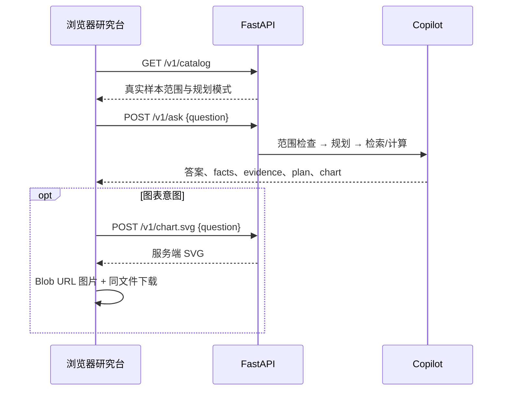

# 金融资料研究台

工作台与 API 由同一个 FastAPI 进程提供。打开根路径即可使用，不依赖 npm 构建、CDN、外部字体或模型 Key。默认运行离线规划，对两家虚构公司的年度样本进行检索和计算。

## 启动与第一条查询

```bash
uv sync --frozen --all-extras
uv run --frozen --all-extras uvicorn finevidence.api:app --host 127.0.0.1 --port 8012
```

访问 http://127.0.0.1:8012/ 。页面默认提交“青禾科技2023至2025年收入画图”，调用真实本地接口。首次渲染的数字、资料和图表来自服务响应。

| 问题 | 页面输出 | 可以核对的内容 |
| --- | --- | --- |
| 青禾科技2023至2025年收入画图 | 三张年度数值卡、趋势条形图、SVG 导出 | 2023/2024/2025 收入分别为 10000/12000/15000 万元 |
| 比较青禾科技和澄海制造2025年净利率 | 两家公司指标卡、比较表、资料原文 | 青禾 10.00%，澄海 4.00%；净利润除以营业收入 |
| 青禾科技2025年营业收入同比 | 同比结果与公式 | (15000 - 12000) / 12000 × 100 = 25.00% |
| 利润为什么和现金流不同 | 资料摘录、引用卡片 | 权责发生制、经营现金收支等原文，不生成无来源结论 |
| 青禾科技最新收入 | 澄清提示，保留问题 | 固定样本没有实时数据，不用默认年度替代“最新” |

输入框支持 `Ctrl / Cmd + Enter`；每次处理一个指标。示例按钮直接执行查询。研究过程中禁用重复提交，完成后同时展示查询计划、公式、取数来源与文档片段。

## 页面分区

- **资料范围条**：从 `/v1/catalog` 获取公司数、年度范围与资料数；这些数量来自已加载数据。
- **研究输入**：500 字限制、字符计数、快捷键、正在处理提示与 HTTP 错误信息。
- **指标结果**：数字卡使用服务端结果；金额为万元，比例为百分数。最多显示三个摘要卡，明细表保留全部结果。
- **图表**：通过 `/v1/chart.svg` 生成，支持负值零轴；下载同一张已显示的 SVG。
- **证据资料**：展开资料原文，保留 `source` 与片段 ID。结构化数值来源单列，避免把说明性文字当成计算依据。
- **查询计划**：任务类型、公司、年度、指标口径、原始检索问题、规划模式与资料版本。
- **最近研究**：只在当前浏览器存储最近 8 个问题，支持清空。点击会再次调用 API，不把历史答案当成当前答案。
- **复制结果**：一起复制答案、公式、来源、资料版本和样本说明。

## 请求流程



图表接口按照同一问题重新执行一次查询，保留现有 API 契约。因此图表查询会产生两条服务端运行记录。离线固定样本结果确定；页面展示的处理耗时仅来自 `/v1/ask`，不包含网络等待与第二次 SVG 请求。当前没有流式输出。

## 实现与安全边界

静态页面位于 `src/finevidence/web/`，包括 `index.html`、`app.css`、`app.js` 与原创 `logo.svg`。静态路由使用 FastAPI `StaticFiles`，首页固定为包内文件，不接受任意文件路径。

查询、答案、计划和证据使用 `textContent` 和 DOM 节点渲染，不拼接用户 HTML。图表通过 `img` 与 Blob URL 呈现，不把 SVG 内容插入页面 DOM；更新时回收旧 URL。页面使用同源资源与严格 CSP，不加载第三方脚本。服务默认绑定 `127.0.0.1`；如需公开部署，应先补鉴权与访问控制。

样本公司、报表、金额和说明均为虚构，页面顶部与资料内容均显示范围；不提供实时行情或交易建议。默认离线规划并非真实大模型推理。可选模型规划需在服务端配置环境变量，不在浏览器保存密钥。

## 验证

```bash
uv run --frozen --all-extras pytest
uv run --frozen --all-extras ruff check .
uv run --frozen --all-extras python tools/evaluate.py
uv run --frozen --all-extras python tools/smoke_http.py
```

`tests/test_workbench.py` 检查首页与静态资源、CSP、资料范围动态变化、页面示例与接口能力对应、SVG 结构、澄清结果与目录穿越拒绝。

2026-10-12 浏览器验收已验证收入图表、公司比较、概念资料、收入同比、缺失年度提示、模拟 HTTP 429 后重试、SVG 下载，以及桌面与 390 px 手机布局。两种屏幕均无页面横向溢出与 JavaScript 错误，Logo 正常加载。截图见 [桌面研究台](screenshots/workbench.png) 与 [手机版](screenshots/mobile.png)。

## 扩展顺序

接入真实资料时，先确认数据使用权限、报告期、币种、金额单位与合并范围，再加入资料导入和版本管理。后续可以增加混合检索与重排、返回单次计算的图表文件、历史运行归档与多用户鉴权。
